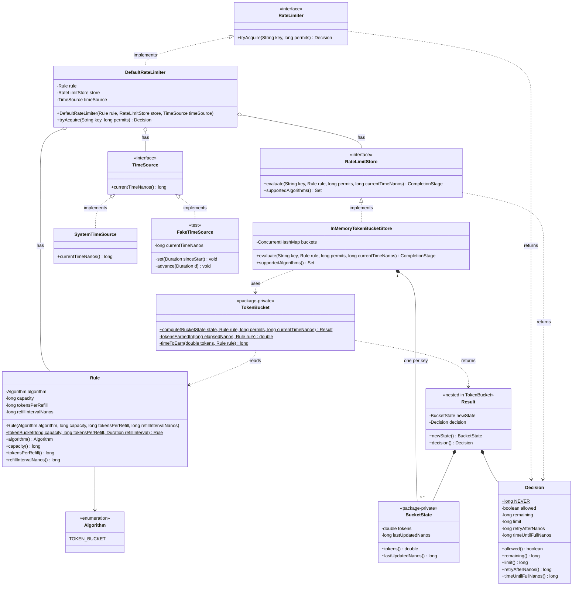

# Token Bucket: Low-Level Design

Scope: the in-memory, single-JVM token bucket in `ratelimiter-core` (Milestones 1–2).
The Redis store (Phase 2) must plug into the same interfaces without changing any class below.

Running example: **capacity 4, refill 1 token per second, bucket starts full.**

---

## 1. Requirements

### Functional

1. A caller asks: "can key `X` take `N` permits now?"
2. Each key has its own bucket.
3. A bucket holds at most `capacity` tokens.
4. Tokens refill at `tokensPerRefill` per `refillInterval` (e.g. 1 per second).
5. If the bucket has at least `N` tokens: allow, and remove `N` tokens.
6. Otherwise: reject, and report how long to wait before retrying.
7. The answer also reports how many tokens remain (needed for HTTP headers later).

### Non-functional

1. Thread-safe: 100 threads on one key never get more than `capacity` allowed.
2. No background thread. Refill is calculated when a request arrives.
3. Testable without `Thread.sleep` (time is injected).
4. A Redis store can be added later without changing these classes.

### Non-goals (v1)

- Eviction of idle keys (see Known limitations).
- Multiple rules per request.
- Algorithms other than token bucket.

---

## 2. Finding the classes: nouns and verbs

### Sentences describing the system

1. A **caller** asks the **rate limiter** to **acquire** **permits** for a **key**.
2. The rate limiter **reads** the current **time**.
3. The rate limiter asks the **store** to **evaluate** the request.
4. The store **loads** the **bucket** for that key, or **creates** a full one.
5. A bucket has **tokens** and a **last refill time**.
6. Every bucket follows a **rule**: a **capacity**, **refill tokens** and a **refill period**.
7. The bucket **refills** tokens for the time passed since the last refill, up to capacity.
8. If there are enough tokens, the request is **allowed** and the tokens are **removed**.
9. Otherwise, the request is **rejected**, with a **retry-after** time.
10. The store **saves** the new bucket and **returns** a **decision**.

### Nouns

caller, rate limiter, permits, key, time, store, bucket, tokens, last refill time, rule, capacity, refill tokens, refill period, retry-after, decision

### Verbs

acquire, read time, evaluate, load, create, refill, allow, remove, reject, save, return

### Filtering nouns: class or field?

Rule of thumb: a noun with its own data or behavior becomes a class. A plain number or text becomes a field. Values that always travel together are grouped into one class.

| Noun | Becomes | Reason |
|---|---|---|
| caller | nothing | Outside the library |
| rate limiter | `RateLimiter` (interface) + `DefaultRateLimiter` | Public entry point |
| key | `String` | Just an identifier |
| permits | `long` | Just a number |
| time | `TimeSource` (interface) | Must be replaceable by a fake clock in tests |
| store | `RateLimitStore` (interface) + `InMemoryTokenBucketStore` | In-memory now, Redis later |
| bucket | `BucketState` (immutable class) | Holds per-key data |
| tokens, last refill time | fields of `BucketState` | Plain numbers |
| rule | `Rule` (immutable class) | Groups capacity + refill tokens + refill period |
| capacity, refill tokens, refill period | fields of `Rule` | Plain numbers |
| decision | `Decision` (immutable class) | Groups allowed + remaining + retry-after |
| retry-after | field of `Decision` | Plain number |

### Assigning verbs to owners

Ask: *who has the data needed to do this action?*

| Verb | Owner | Method |
|---|---|---|
| acquire | `RateLimiter` | `tryAcquire(key, permits)` |
| read time | `TimeSource` | `currentTimeNanos()` |
| evaluate, load, create, save | `RateLimitStore` | `evaluate(key, rule, permits, currentTimeNanos)` |
| refill, allow, remove, reject | `TokenBucket` | `compute(state, rule, permits, currentTimeNanos)` |
| validate rule | `Rule` | compact constructor |

The math (`TokenBucket`) is separate from the store because they are two jobs:
the store keeps state safe under concurrency; the math calculates tokens.
Keeping the math pure also lets it be ported line by line to Lua for the Redis store.

---

## 3. Rule vs Decision

They are the input and the output of one call.

```
         Rule (the limit)                     Decision (the answer)
"4 tokens, refill 1 per second"   ──►   "allowed, 2 left, retry in 0"
```

| | `Rule` | `Decision` |
|---|---|---|
| Role | Input / configuration | Output / result |
| Created by | Library user, once at startup | Rate limiter, on every request |
| Lifetime | Whole application | One request |
| Changes per request | No | Yes |
| Analogy | Speed-limit sign | Result for one car |

A `boolean` return is not enough: the HTTP layer needs `X-RateLimit-Limit`,
`X-RateLimit-Remaining`, `X-RateLimit-Reset` and `Retry-After`, so the answer
must carry those values.

---

## 4. Class design

Fields and signatures only. Bodies are implementation work.

```java
// --- Value objects ---
// Plain final classes, not records. Every field is private final, there are
// no setters, and each class must override equals/hashCode/toString itself.

enum Algorithm { TOKEN_BUCKET }

public final class Rule {
    private final Algorithm algorithm;
    private final long capacity;           // max tokens, e.g. 4
    private final long tokensPerRefill;       // e.g. 1
    private final long refillIntervalNanos;  // e.g. 1_000_000_000 (1 s)

    private Rule(Algorithm algorithm, long capacity, long tokensPerRefill, long refillIntervalNanos);
    // Constructor rejects: algorithm == null, capacity <= 0,
    // tokensPerRefill <= 0, refillIntervalNanos <= 0.

    public static Rule tokenBucket(long capacity, long tokensPerRefill, Duration refillInterval);

    public Algorithm algorithm();
    public long capacity();
    public long tokensPerRefill();
    public long refillIntervalNanos();

    @Override public boolean equals(Object o);
    @Override public int hashCode();
    @Override public String toString();
}

public final class Decision {
    private final boolean allowed;
    private final long remaining;        // whole tokens left after this request
    private final long limit;            // = rule.capacity()
    private final long retryAfterNanos;  // 0 when allowed
    private final long timeUntilFullNanos;  // time until the bucket is full again

    public Decision(boolean allowed, long remaining, long limit,
                    long retryAfterNanos, long timeUntilFullNanos);

    public boolean allowed();
    public long remaining();
    public long limit();
    public long retryAfterNanos();
    public long timeUntilFullNanos();

    @Override public boolean equals(Object o);
    @Override public int hashCode();
    @Override public String toString();
}

final class BucketState {                 // package-private
    private final double tokens;
    private final long lastUpdatedNanos;

    BucketState(double tokens, long lastUpdatedNanos);

    double tokens();
    long lastUpdatedNanos();
    // No equals/hashCode needed: CAS compares references, not values.
}

// --- Interfaces ---

interface TimeSource {
    long currentTimeNanos();
}

interface RateLimitStore {
    CompletionStage<Decision> evaluate(String key, Rule rule, long permits, long currentTimeNanos);
    Set<Algorithm> supportedAlgorithms();
}

interface RateLimiter {
    Decision tryAcquire(String key, long permits);
}

// --- Implementations ---

final class SystemTimeSource implements TimeSource { }   // wraps System.nanoTime()

final class TokenBucket {                                 // pure math, no fields
    static Result compute(BucketState state, Rule rule, long permits, long currentTimeNanos);

    static final class Result {
        private final BucketState newState;
        private final Decision decision;
        Result(BucketState newState, Decision decision);
        BucketState newState();
        Decision decision();
    }
}

final class InMemoryTokenBucketStore implements RateLimitStore {
    private final ConcurrentHashMap<String, AtomicReference<BucketState>> buckets;
}

final class DefaultRateLimiter implements RateLimiter {
    private final Rule rule;
    private final RateLimitStore store;
    private final TimeSource timeSource;
}

// --- Test only ---

final class FakeTimeSource implements TimeSource { void advance(Duration d); }
```

### Design decisions

| Decision | Choice | Reason |
|---|---|---|
| Rule shape | capacity + refill tokens per refill period | A rate as a ratio of integers stays exact ("100 per minute" as `double` tokens/s is 1.666…) |
| Units | `Duration` at the public boundary, `long` nanos internally | Lua has no `Duration`; one internal unit avoids conversion bugs |
| Token type | `double` | Refill produces fractions (0.3 s = 0.3 tokens); `long` would drop them on every call. Redis Lua numbers are doubles too, so both stores do the same math |
| Value objects | Plain `final` classes, `private final` fields, no setters | Explicit control over constructors and accessors; immutability is kept by hand instead of by `record` |
| Validation | Private constructor behind `Rule.tokenBucket(...)` | An invalid `Rule` cannot exist |
| Times in `Decision` | Relative (retry after N nanos) | `System.nanoTime()` is not a wall clock; the HTTP layer converts to epoch seconds |
| State per key | One immutable `BucketState` object in one `AtomicReference` | Both fields change atomically together (see §7) |

Open for Phase 2: Lua doubles are exact only up to 2^53 (~9e15). Epoch nanos (~1.7e18) exceed this; epoch micros (~1.7e15) do not. The Redis store must work in micros or relative time.

---

## 5. Class diagram



`buckets` is a `ConcurrentHashMap<String, AtomicReference<BucketState>>`: one entry per key.
`RateLimitStore.evaluate` returns `CompletionStage<Decision>`; `supportedAlgorithms` returns `Set<Algorithm>`.
`equals`, `hashCode` and `toString` on `Rule` and `Decision` are omitted from the diagram.

### Notation

| Symbol | Meaning |
|---|---|
| `+` / `-` / `~` | public / private / package-private |
| `$` | static |
| `<\|..` (dotted line, hollow triangle) | implements an interface |
| `o--` (hollow diamond) | has a field referencing it; the object is passed in from outside |
| `*--` (filled diamond) | owns it; created and held internally |
| `..>` (dotted arrow) | uses: calls or returns it, keeps no field |
| `-->` (solid arrow) | has a field of that type |

### Relationships

| From | Relation | To |
|---|---|---|
| `DefaultRateLimiter` | implements | `RateLimiter` |
| `DefaultRateLimiter` | has | `Rule`, `RateLimitStore`, `TimeSource` |
| `SystemTimeSource`, `FakeTimeSource` | implement | `TimeSource` |
| `InMemoryTokenBucketStore` | implements | `RateLimitStore` |
| `InMemoryTokenBucketStore` | owns many (one per key) | `BucketState` |
| `InMemoryTokenBucketStore` | uses | `TokenBucket.compute` |
| `TokenBucket` | returns | `Result` (new `BucketState` + `Decision`) |
| `TokenBucket` | reads | `Rule` |
| `Rule` | has | `Algorithm` |

### Dependency direction

```
             DefaultRateLimiter
              │            │
              ▼            ▼
        TimeSource   RateLimitStore
                           ▲
                           │ implements
              InMemoryTokenBucketStore
                           │
                           ▼
                      TokenBucket ──► BucketState, Rule, Decision
```

Nothing points upward. `TokenBucket` depends only on the value classes.
`RateLimiter` holds no maps or counters; all bucket state lives in the store.
Phase 2 adds one class, `RedisTokenBucketStore implements RateLimitStore`, beside
`InMemoryTokenBucketStore`. Nothing else in the diagram changes.

---

## 6. Request flow

```
Caller → DefaultRateLimiter.tryAcquire("user42", 1)
  0. permits <= 0 → IllegalArgumentException
  1. now = timeSource.currentTimeNanos()
  2. store.evaluate("user42", rule, 1, now)
       3. ref = buckets.computeIfAbsent("user42", k -> new AtomicReference<>(null))
       4. old = ref.get()                          // null on first request
       5. result = TokenBucket.compute(old, rule, 1, now)
       6. ref.compareAndSet(old, result.newState())
            skipped when newState == old (rejection: nothing changed)
            failed? → another thread won, go back to 4
       7. return completedFuture(result.decision())
  8. .toCompletableFuture().join()
← Decision
```

### Inside `TokenBucket.compute`

1. No state yet: start full (`tokens = capacity`, `lastUpdated = now`).
2. `elapsed = now − lastUpdated`. If negative (clock went backwards), use 0.
3. `tokens = min(capacity, tokens + elapsed × tokensPerRefill ÷ refillIntervalNanos)`.
4. If `tokens ≥ permits`: allowed, `tokens −= permits`.
5. Else: rejected, `retryAfter` = time to earn the missing `permits − tokens`
   (`Decision.NEVER` when `permits > capacity`).
6. Allowed: return a new state (`tokens`, `lastUpdated = now`) plus the decision.
   Rejected: return the **same** state instance, so the store skips the write.
   Recomputing later from the older `lastUpdated` gives the same token count,
   and rejections under contention cause no CAS traffic.

Guard: with a very long idle gap, `elapsed × tokensPerRefill` can be huge. Clamp `elapsed`
to the time needed to fill the bucket before multiplying.

### Worked example (capacity 4, 1 token/s)

| t (s) | Tokens before | After refill | Result | Retry after | Tokens after |
|---|---|---|---|---|---|
| 1.0 | new bucket | 4.0 | allow | – | 3.0 |
| 3.2 | 3.0 | 4.0 (capped) | allow | – | 3.0 |
| 3.4 | 3.0 | 3.2 | allow | – | 2.2 |
| 3.6 | 2.2 | 2.4 | allow | – | 1.4 |
| 3.8 | 1.4 | 1.6 | allow | – | 0.6 |
| 4.1 | 0.6 | 0.9 | **reject** | 0.1 s | 0.9 |
| 4.3 | 0.9 | 1.1 | allow | – | 0.1 |
| 4.5 | 0.1 | 0.3 | **reject** | 0.7 s | 0.3 |
| 4.7 | 0.3 | 0.5 | **reject** | 0.5 s | 0.5 |
| 4.9 | 0.5 | 0.7 | **reject** | 0.3 s | 0.7 |
| 6.5 | 0.7 | 2.3 | allow | – | 1.3 |
| 7.5 | 1.3 | 2.3 | allow | – | 1.3 |
| 9.0 | 1.3 | 2.8 | allow | – | 1.8 |

Result: 9 allowed, 4 rejected (4.1, 4.5, 4.7, 4.9). This is the M2 acceptance test.

---

## 7. Concurrency

**Race:** threads A and B both read 1 token, both decide "allow", both save 0.
Two requests are admitted for one token.

**Fix:** one `AtomicReference<BucketState>` per key and `compareAndSet`.
Only one thread's write wins; the loser recomputes from the fresh state and sees 0 tokens.

Rules:

- Both fields live in **one** immutable object. Two separate `AtomicLong`s can be
  updated half-way by different threads.
- `compute` always returns a **new** `BucketState` instance, because CAS compares references.
- Atomics and the map exist only inside `InMemoryTokenBucketStore`. `TokenBucket` stays pure.

---

## 8. Edge cases and tests

| Case | Expected |
|---|---|
| Invalid `Rule` (capacity 0, refill 0, period 0, null algorithm) | Constructor throws |
| First request for a key | Bucket starts full |
| Worked example stream (§6) | 9 allowed; rejected at 4.1, 4.5, 4.7, 4.9 |
| Long idle (1 hour) | Tokens = capacity, no overflow |
| Clock goes backwards | No tokens added |
| `permits > capacity` | Always rejected; `retryAfterNanos = Decision.NEVER` (`Long.MAX_VALUE`) |
| `permits <= 0` | `IllegalArgumentException` from `DefaultRateLimiter` and from the store (negative permits would add tokens) |
| 100 threads, one key, capacity 10, started together via `CountDownLatch` | Exactly 10 allowed |
| Two different keys | Independent buckets |

All time-based tests use `FakeTimeSource`; none use `Thread.sleep`.

---

## 9. Known limitations (v1)

- The in-memory map never removes idle keys; memory grows with key count. Redis TTL addresses this in Phase 2.
- Single JVM only: three instances with limit 100 admit up to 300.

---

## 10. Build order

1. `Algorithm`, `Rule` + invalid-rule test. `./mvnw verify`. Commit (M1).
2. `Decision`, `BucketState`, `TimeSource`, `FakeTimeSource`.
3. `TokenBucket.compute` + worked-example tests (no threads yet).
4. `InMemoryTokenBucketStore` + 100-thread test.
5. `DefaultRateLimiter`. Commit (M2).
